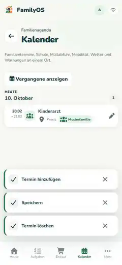

# Kalender

Im Kalender siehst du eigene FamilyOS-Termine und – wenn eingerichtet – Termine aus verbundenen Quellen.

## Überblick behalten

Öffne **Kalender**. Standardmäßig startet FamilyOS in der **Wochenansicht**. Oben wechselst du zwischen **Woche**, **Monat** und **Liste**.

- **Woche** zeigt die sieben Tage kompakt und darunter den ausgewählten Tag.
- **Monat** hilft bei der längerfristigen Orientierung; ein Tag lässt sich direkt auswählen.
- **Liste** behält die bisherige Agenda bei und gruppiert Termine nach Datum. Dort kannst du bei Bedarf auch vergangene Termine einblenden.

Mit **Heute** springst du zurück zum aktuellen Zeitraum. In Woche und Monat wechselst du mit den Pfeilen zum vorherigen oder nächsten Zeitraum. Die gewählte Ansicht bleibt in der URL erhalten, sodass Neu laden und Browser-Navigation nicht unerwartet auf eine andere Ansicht zurückspringen.

Du kannst Quellen filtern. Das ist praktisch, wenn zum Beispiel Familienkalender, Abfalltermine oder externe Kalender gleichzeitig sichtbar sind.

## Wochenkompass auf Heute

Der **Wochenkompass** auf **Heute** zeigt die aktuelle Kalenderwoche mit relevanten Markierungen. Mit den Pfeilen kannst du eine Woche vor- oder zurückgehen. Sobald du die aktuelle Woche verlassen hast, bringt **Heute** dich mit einem Tipp wieder zurück.

Ein Tipp auf einen Wochentag öffnet den Kalender direkt auf diesem Datum. Der Kalender startet dabei weiterhin in der Wochenansicht.

## Eigenen Termin anlegen

Nutze die Anlegen-Aktion für einen Termin und trage die nötigen Angaben ein.

Halte den Titel kurz. Ergänze Uhrzeit und weitere Angaben nur, wenn sie gebraucht werden.

## Eigenen Termin bearbeiten

Termine, die direkt in FamilyOS angelegt wurden, kannst du wieder öffnen und bearbeiten.

## Warum kann ich einen Termin nicht bearbeiten?

Ein Termin kann aus einer externen Quelle stammen – zum Beispiel aus einem eingebundenen Kalender.

Solche Einträge sind in FamilyOS in der Regel **nur lesbar**. Änderungen nimmst du dann in der ursprünglichen Quelle vor. Beim nächsten Sync übernimmt FamilyOS den aktuellen Stand.

## Vergangene Termine

Wenn du ältere Einträge brauchst, wechsle in die **Liste** und blende vergangene Termine ein. Im Alltag bleiben sie sonst im Hintergrund.

## Externe Kalender verbinden

Kalenderquellen richtest du unter den **Integrationen** ein.

Mehr dazu: **[Integrationen](integrations.md)**.
